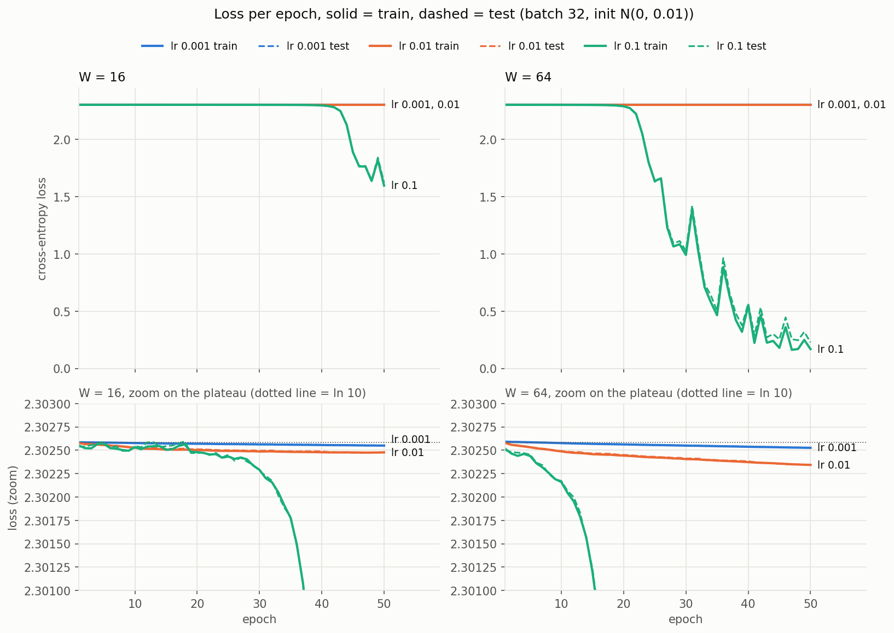

# Lab 2: A neural network from scratch

## 1. Goal

Build a two-hidden-layer neural network in plain NumPy (no deep learning framework), implement the
forward pass, the cross-entropy loss and backpropagation by hand, prove that the gradients are
correct with numerical gradient checking, train it on the digits dataset with three learning rates
and two hidden widths, and measure how long the forward and the backward pass take.

## 2. Method

**Environment.** The same pinned environment as Lab 1: Python 3.11.8, numpy 1.26.4, scikit-learn
1.5.0 (only for the dataset and the split), matplotlib 3.9.0. AMD64 laptop CPU (AMD Family 25
Model 116, 16 logical CPUs), Windows 11. All computations are in float64.

**Data.** `load_digits(return_X_y=True)`: 1797 images of 8×8 pixels, values 0–16, 10 classes.
The pixels are divided by 16, so every input is in [0, 1]. The labels are one-hot encoded
(10 columns). Stratified 70/30 split with `random_state=42`: 1257 training and 540 test samples,
122–128 per class in train and 52–55 per class in test.

**Network design.** Input 64 → hidden W → ReLU → hidden W → ReLU → output 10 → softmax,
for W = 16 and W = 64. B is the batch size.

| Layer | Operation | Weight | Bias | Output | Parameters, W = 16 | W = 64 |
|---|---|---|---|---|---|---|
| 1 | Z1 = X·W1 + b1, A1 = ReLU(Z1) | (64, W) | (W,) | (B, W) | 1040 | 4160 |
| 2 | Z2 = A1·W2 + b2, A2 = ReLU(Z2) | (W, W) | (W,) | (B, W) | 272 | 4160 |
| 3 | Z3 = A2·W3 + b3, P = softmax(Z3) | (W, 10) | (10,) | (B, 10) | 170 | 650 |
| | | | | **Total** | **1482** | **8970** |

The weights are drawn from N(0, 0.01), read as mean 0 and **standard deviation** 0.01 (the
`np.random.normal(0, 0.01)` convention). The manual does not specify the biases, so they start at 0.
Seed 42 is used for the initialisation and for shuffling.

**Loss.** Mean cross-entropy over the batch: L = −(1/B) Σᵢ Σₖ Yᵢₖ log Pᵢₖ. Softmax subtracts
the row maximum before `exp` for numerical stability (this does not change the result).

**Gradients by the chain rule.** For one sample, softmax and cross-entropy together give
∂L/∂z3ₖ = pₖ − yₖ, so for the batch mean:

| Step | Formula | Shape |
|---|---|---|
| output | dZ3 = (P − Y) / B | (B, 10) |
| layer 3 | dW3 = A2ᵀ·dZ3, db3 = Σ_rows dZ3 | (W, 10), (10,) |
| into layer 2 | dA2 = dZ3·W3ᵀ, dZ2 = dA2 ⊙ [Z2 > 0] | (B, W) |
| layer 2 | dW2 = A1ᵀ·dZ2, db2 = Σ_rows dZ2 | (W, W), (W,) |
| into layer 1 | dA1 = dZ2·W2ᵀ, dZ1 = dA1 ⊙ [Z1 > 0] | (B, W) |
| layer 1 | dW1 = Xᵀ·dZ1, db1 = Σ_rows dZ1 | (64, W), (W,) |

Each linear layer Z = A·W + b gives back dW = Aᵀ·dZ, db = the sum of dZ over the batch and
dA = dZ·Wᵀ; ReLU lets the gradient through only where its input was positive. The gradient for the
input X itself is not needed, because X has no parameters. Every gradient has the same shape as
its parameter.

**Protocols.**

| Step | Protocol |
|---|---|
| Forward checks | Output shape and max \|row sum − 1\| for inputs of 1, 32, 1257 and 540 rows; loss of the untrained network on the full training set |
| Gradient check | One fixed batch of 32 training samples. 10 random weights from W1, W2, W3; each nudged by ±1e-5; central difference (L(w+h) − L(w−h)) / 2h; rel. error = \|a − n\| / max(\|a\|, \|n\|). Weights are drawn only among those with a non-zero analytic gradient (see §3.3). Number of ReLU inputs that change sign under the nudge is counted |
| Training | SGD, batch 32 (the last batch of every epoch has 9 samples), 50 epochs, training set reshuffled every epoch, same seed for every run. After every epoch: loss and accuracy on the full training and test sets |
| Timing | `time.perf_counter_ns`, a 1 s busy loop to bring the CPU to its steady clock, 20 warm-up rounds, then 100 rounds; in every round each measured function runs once, so clock changes affect all of them equally. Median reported. Backward is timed without the forward pass that makes its cache. Batches 32 and 1257 |

**Code** (`src/`): `common.py` (seed, data), `network.py` (init, forward, loss, backward),
`sanity_checks.py` (steps 1–4), `gradient_check.py` (step 5), `train.py` (step 6), `timing.py`
(step 7). Run from `lab02/src`. Running every script again gives the same results, except the
timings: `training_history.csv` is byte-identical between runs.

## 3. Results

### 3.1 Data and forward pass (steps 1–3)

All checks pass ([`sanity_checks.txt`](results/sanity_checks.txt)): inputs are in [0, 1], every
one-hot row sums to 1, and for both widths the output has shape (B, 10) for B = 1, 32, 1257 and 540.
The largest difference between a row sum and 1 is **4.4e-16** (limit 1e-6).

### 3.2 Initial loss (step 4)

| W | Untrained train loss | ln(10) | Difference |
|---|---|---|---|
| 16 | 2.302586 | 2.302585 | +4.3e-7 |
| 64 | 2.302592 | 2.302585 | +7.4e-6 |

With weights of size 0.01 the outputs Z3 are almost zero, softmax gives almost exactly 0.1 to
every class, and the loss is −ln(0.1) = ln(10), as expected.

### 3.3 Gradient check (step 5)

Full tables: [`gradient_check.txt`](results/gradient_check.txt).

| Network state | W = 16 | W = 64 | Largest rel. error |
|---|---|---|---|
| **Trained** (init N(0, 0.01), then the 50-epoch lr 0.1 run) | **10/10, PASSED** | **10/10, PASSED** | 7.2e-7 / 9.2e-8 |
| Untrained, N(0, 0.01) | 4/10, failed | 5/10, failed | 8.1e-6 / 2.2e-6 |
| Untrained, N(0, 2/fan_in) (He scale) | 10/10, PASSED | 10/10, PASSED | 5.3e-8 / 8.2e-8 |

No nudge crossed a ReLU kink (0 sign changes in all 60 checks), so the finite difference is valid
everywhere.

The check passes on the trained network (with the initialisation required by the manual) and on
a network with larger random weights. It fails only on the **untrained N(0, 0.01)** network, and
this is a limit of the test, not an error in `backward`:

- At this initialisation the gradients are very small, about 1e-7 to 1e-4.
- The central difference subtracts two losses of about 2.3 that differ only in the 11th digit.
  float64 rounding gives an absolute error of about 2.2e-16 · 2.3 / (2 · 1e-5) ≈ 2.5e-11 in the
  numerical slope.
- Divided by a gradient of 1e-6–1e-5, this alone is a relative error of 1e-6–1e-5. All failing
  weights have small gradients (below 2.9e-5), and their absolute error |a − n| is 7e-13 to 4e-11,
  the predicted size. The rounding error is random, so a few weights with similar small gradients
  pass by chance, and the weights with larger gradients (up to 7.9e-5) pass.

The same effect is visible in the trained W = 16 network: its smallest gradient (1.4e-5) has the
largest error (7.2e-7), still under the limit.

Weights with a gradient of exactly zero are skipped, because there both slopes are 0 and the check
passes without testing anything. In this batch 35–39% of the W = 16 weights and 23–30% of the
W = 64 weights have a zero gradient: inputs from border pixels that are 0 in every image of the
batch, or ReLU units that are off for all 32 samples. An earlier version that drew from all weights
"passed" 2 of the 10 weights this way in every configuration.

### 3.4 Training (step 6)

Per-epoch log: [`training_log.txt`](results/training_log.txt), all numbers:
[`training_history.csv`](results/training_history.csv),
[`final_accuracy.csv`](results/final_accuracy.csv).

Final results after 50 epochs:

| W | lr | Train loss | Test loss | Train acc. | **Test acc.** | Leaves the plateau (train loss < 2.25) |
|---|---|---|---|---|---|---|
| 16 | 0.001 | 2.30255 | 2.30255 | 0.1018 | **0.1019** | no |
| 16 | 0.01 | 2.30248 | 2.30248 | 0.1018 | **0.1019** | no |
| 16 | 0.1 | 1.5970 | 1.6237 | 0.3222 | **0.3259** | epoch 43 |
| 64 | 0.001 | 2.30253 | 2.30253 | 0.1018 | **0.1019** | no |
| 64 | 0.01 | 2.30234 | 2.30234 | 0.1018 | **0.1019** | no |
| 64 | 0.1 | 0.1684 | 0.2271 | 0.9467 | **0.9389** | epoch 22 |

(0.1019 = 55/540 = the share of the class that the network always predicts, i.e. chance level.)

- **All runs start on a plateau at loss ln(10).** With weights of 0.01, the signal is multiplied
  by three small matrices on the way forward, and every weight's gradient is multiplied by the
  other two small matrices on the way back. The output is almost constant and the gradients are
  ~1e-5, so the weights grow very slowly at first. As they grow, the gradients grow too, and then
  the loss falls quickly. This is why the lr 0.1 curves are flat for 20–40 epochs and then drop.
- **lr 0.001 and 0.01 stay on the plateau for all 50 epochs.** Their loss falls only in the 4th–5th
  decimal place (see the zoomed lower panels). This is not a bug: in an extra run outside the
  graded grid (same code, 400 epochs, lr 0.01), the network left the plateau at epoch **214** for
  W = 64 (10× later than with lr 0.1 at epoch 22; test accuracy 0.907 after 400 epochs) and at epoch
  **399** for W = 16 (9× later than epoch 43). With a 10× smaller step the escape takes about 10× more
  epochs, as expected if the escape speed is proportional to the learning rate.
- **The wider network learns much earlier.** With lr 0.1, W = 64 leaves the plateau at epoch 22
  and reaches 93.9% test accuracy; W = 16 leaves it only at epoch 43 and reaches 32.6%, so it is
  still learning when the 50 epochs end. In the wider network each unit of layers 2 and 3 sums
  4× more inputs (64 instead of 16), so the signal and the gradients are larger at the start.
- **lr 0.1 is a large step** once W = 64 has left the plateau: the loss jumps up for one epoch
  several times (the biggest jumps at epochs 31 and 36, from 1.0 to 1.4 and from 0.47 to 0.88),
  and then comes back down.
- **Almost no overfitting:** for the best run the test loss (0.227) stays close to the train loss
  (0.168), and the accuracies differ by 0.8 percentage points.

### 3.5 Forward and backward timing (step 7)

[`timing.txt`](results/timing.txt), all 100 samples per pass: [`timing_raw.csv`](results/timing_raw.csv).
Median times in microseconds:

| W | Batch | Forward | Backward | Backward / forward | Matmuls only, fwd / bwd | Matmul share of the pass, fwd / bwd | MACs, fwd / bwd | MAC ratio |
|---|---|---|---|---|---|---|---|---|
| 16 | 32 | 17.6 | 19.0 | 1.08 | 4.4 / 7.7 | 25% / 41% | 46 k / 59 k | 1.29 |
| 16 | 1257 | 282.9 | 282.0 | 1.00 | 115.5 / 167.4 | 41% / 59% | 1.81 M / 2.33 M | 1.29 |
| 64 | 32 | 26.4 | 35.1 | **1.33** | 11.2 / 21.1 | 42% / 60% | 0.28 M / 0.43 M | 1.54 |
| 64 | 1257 | 1054.0 | 1347.6 | **1.28** | 432.0 / 557.7 | 41% / 41% | 11.1 M / 17.1 M | 1.54 |

(MAC = one multiply-accumulate in a matrix multiplication.) Between repeated runs of the script the
times change by up to ~10%; the ratios stay the same.

**Backward dominates**, and the reason is the number of matrix multiplications:

- The forward pass has **3** matmuls: X·W1, A1·W2, A2·W3. Their cost is
  B·(64W + W² + 10W) MACs.
- The backward pass has **5** matmuls: one dW = Aᵀ·dZ per layer (the same cost as the forward pass)
  plus dA2 = dZ3·W3ᵀ and dA1 = dZ2·W2ᵀ, which add B·(10W + W²). So backward needs
  1 + (W² + 10W)/(W² + 74W) times the work of forward: **1.29×** for W = 16 and **1.54×** for W = 64.
  The ratio grows with W because the W×W layer becomes a larger part of the work.
- For W = 64 this shows clearly: backward is 1.28–1.33× slower than forward, and its matmuls alone
  take 1.3–1.9× as long as the forward matmuls. The matmul ratio is a bit higher than the MAC ratio
  for small batches, because backward makes more matmul calls (5 vs 3), each with a fixed cost,
  and works with transposed matrices.
- For W = 16 forward and backward take about the same time. The matrices are so small that
  matmuls are only 25–59% of the time; the rest is per-call NumPy overhead and element-wise work.
  Forward has the expensive element-wise part: softmax (`max`, `exp`, `sum`, division). This
  balances the two extra matmuls of backward.
- Time grows with the amount of matmul work: from W = 16 to W = 64 at batch 1257 the forward MACs
  grow 6.1× and the forward time 3.7×. With bigger layers the matmul part would dominate even
  more, and the backward/forward time ratio would get closer to the MAC ratio (and to the usual
  rule of thumb that backward costs about 2× forward, which counts dX for the first layer too).

## 4. Conclusions

1. **The hand-derived backpropagation is correct.** On the trained network with the required
   initialisation all 10 checked weights pass for both widths (largest relative error 7.2e-7 for
   W = 16 and 9.2e-8 for W = 64), and also on a network with larger random weights. On the untrained
   N(0, 0.01) network only 4–5 of 10 pass. This is not a bug: those gradients (~1e-6) are so small
   that float64 rounding in the numerical slope (~2.5e-11) is already more than 1e-6 of them.
   A gradient check is only useful where the gradients are large compared to this rounding error,
   and weights with zero gradient should not be counted.

2. **The N(0, 0.01) initialisation makes training slow, and the learning rate decides whether the
   network learns at all in 50 epochs.** Every run starts on a flat region with loss ln(10).
   Only lr 0.1 leaves it within 50 epochs; lr 0.001 and 0.01 stay at chance level (10.2% test
   accuracy). The best result is **W = 64, lr 0.1: 93.9% test accuracy**. W = 16 with lr 0.1 reaches
   only 32.6%, because it leaves the plateau 21 epochs later. With a 10× smaller learning rate the
   escape also takes about 10× longer (epoch 214 instead of 22 for W = 64). A scale that matches
   the layer size (such as He initialisation) would avoid this plateau.

3. **Backward is the more expensive pass, because it has more matrix multiplications.** It needs
   5 matmuls against 3 in forward, which is 1.29× (W = 16) to 1.54× (W = 64) more multiply-accumulate
   work. For W = 64 the measured backward is 1.28–1.33× slower. For W = 16 both passes take the same
   time, because at this size most of the time is NumPy overhead and the softmax, not
   multiplication. The wider the layers, the more the cost is decided by matrix multiplication.
