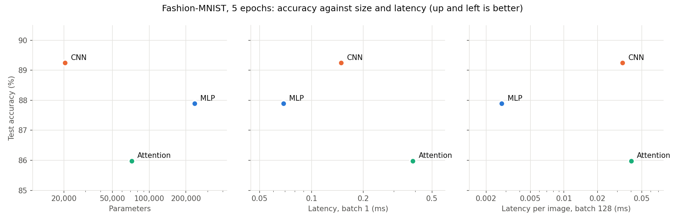

# Lab 3: Architectures and their costs

## 1. Goal

Build three image classifiers of comparable size in PyTorch (an MLP, a CNN and a small
Transformer over image patches), count their parameters and FLOPs by hand and with profiling
tools, explain where the tools disagree with the hand count, measure their inference latency,
train them on Fashion-MNIST, and decide which architecture gives the most accuracy for its cost.

## 2. Method

**Environment.** The same pinned environment as Labs 1–2: Python 3.11.8, torch 2.3.1+cpu,
torchvision 0.18.1, torchinfo 1.8.0, thop 0.1.1.post2209072238, matplotlib 3.9.0. AMD64 laptop
CPU (AMD Family 25 Model 116), Windows 11, PyTorch uses 8 threads. All computations are in float32.

**Data.** `torchvision.datasets.FashionMNIST`, transform `ToTensor()` and
`Normalize((0.2860,), (0.3530,))`. The official 60k training set is split with
`random_split(..., generator=manual_seed(42))` into **55 000 train / 5 000 validation**; the
official **10 000** test images are used only once, after training. Batch size 128.

**Models.** Input (B, 1, 28, 28), output 10 logits.

| Model | Layers |
|---|---|
| MLP | Flatten 784 → Linear 256 → ReLU → Linear 128 → ReLU → Linear 10 |
| CNN | Conv2d(1,16,3,p=1) → ReLU → MaxPool2 → Conv2d(16,32,3,p=1) → ReLU → MaxPool2 → Flatten → Linear(1568,10) |
| Attention | 16 patches of 7×7 (a 4×4 grid, row-major) → Linear 49→64 + learned position embedding → 2 × `nn.TransformerEncoderLayer(d_model=64, nhead=4, dim_feedforward=128, batch_first=True)` → mean over the 16 tokens → Linear 64→10 |

One addition to the manual: the Attention model gets a **learned position embedding**
(16 × 64 = 1 024 parameters). Self-attention and mean pooling are both invariant to the order of
the tokens, so without it the model could not know which patch came from which part of the image.
The encoder layers use the PyTorch defaults (post-norm, ReLU, dropout 0.1 during training).

**Protocols.**

| Step | Protocol |
|---|---|
| Parameters | `torchinfo.summary`, checked against the hand count (an `assert` in `flops.py`) |
| Hand FLOPs | Ch. 4 formulas, one image: Linear 2·in·out, Conv2d 2·K²·C_in·C_out·H_out·W_out, attention as in §3.2. Only multiply-accumulates of matrix products and convolutions are counted; 1 MAC = 2 FLOPs |
| Profilers | `thop.profile` on one image (out of the box, with the Transformer fast path off, and with a custom rule for `nn.MultiheadAttention`), and `torch.utils.flop_counter.FlopCounterMode` as a second tool |
| Latency | `model.eval()` + `torch.inference_mode()`, real test images, 1 s busy loop, 10 warm-up rounds, then **100 runs for batch 1 and 20 runs for batch 128**; inside every round each model runs once (interleaved, so clock drift affects all equally); `time.perf_counter_ns`; median reported |
| Training | Adam, lr 1e-3, batch 128, 5 epochs, cross-entropy; the same seed (42) for initialisation and shuffle order for every model; validation accuracy after every epoch, test accuracy once at the end |

**Code** (`src/`, run from `lab03/src`): `common.py` (seed, data split), `models.py` (the three
models), `flops.py` (step 3: parameters and FLOPs), `latency.py` (step 3: latency), `train.py`
(step 4), `plot_tradeoffs.py` (step 5). Run order: `flops.py`, `latency.py`, `train.py`,
`plot_tradeoffs.py`.

## 3. Results

### 3.1 Parameters

From [`torchinfo_summary.txt`](results/torchinfo_summary.txt); the hand count gives the same totals.

| Model | Parameters | Of which | float32 size |
|---|---|---|---|
| MLP | **235 146** | fc1 200 960 (85 %), fc2 32 896, fc3 1 290 | 0.94 MB |
| CNN | **20 490** | conv1 160, conv2 4 640, fc 15 690 (77 %) | 0.08 MB |
| Attention | **71 818** | patch embed 3 200, position 1 024, 2 × encoder 33 472, head 650 | 0.29 MB |

The architectures as specified do **not** land in the 100k–150k target: the MLP is 1.6× above it,
the CNN 5× below, the Attention model 1.4× below. I kept the specified layers so that the results
match the manual; the comparison is therefore between models whose size differs by up to 11×,
which §4 takes into account (accuracy per parameter, not only accuracy).

Per encoder layer: QKV projection 64·192 + 192 = 12 480, output projection 64·64 + 64 = 4 160,
FFN 64·128 + 128 = 8 320 and 128·64 + 64 = 8 256, two LayerNorms 2·128 = 256 → 33 472.

### 3.2 Hand-calculated FLOPs, one image

Full per-layer table: [`flops_layers.csv`](results/flops_layers.csv). One representative layer of
each type:

**Linear — MLP fc1 (784 → 256).** Every output is a dot product of length 784:
FLOPs = 2 × 784 × 256 = **401 408** (200 704 MACs). This one layer is 85 % of the MLP's work.

**Conv2d — CNN conv2 (16 → 32 channels, 3×3, output 14×14).** Every output value is a dot product
of length K·K·C_in = 3·3·16 = 144, and there are 32·14·14 = 6 272 output values:
FLOPs = 2 × 3 × 3 × 16 × 32 × 14 × 14 = **1 806 336** (903 168 MACs). This layer has only 4 640
parameters but does 88 % of the CNN's work: each weight is reused at all 196 output positions.

**Attention — one encoder layer (seq = 16 tokens, d_model = 64, 4 heads of 16, FFN 128).**

| Part | Formula | FLOPs |
|---|---|---|
| QKV projections | 2 × seq × d_model × 3·d_model = 2 × 16 × 64 × 192 | 393 216 |
| Scores Q·Kᵀ | 2 × seq² × d_model = 2 × 16² × 64 (4 heads × 16² × 16) | 32 768 |
| Weights · V | 2 × seq² × d_model | 32 768 |
| Output projection | 2 × seq × d_model² | 131 072 |
| FFN | 2 × seq × d_model × d_ff × 2 = 2 × 16 × 64 × 128 × 2 | 524 288 |
| **One layer** | | **1 114 112** |

Only 5.9 % of a layer is the seq²-part (scores and weights·V), because seq = 16 is much smaller
than d_model = 64; the rest is ordinary Linear work applied to each of the 16 tokens.

**Model totals.**

| Model | Hand MACs | Hand FLOPs | FLOPs per parameter |
|---|---|---|---|
| MLP | 234 752 | **469 504** | 2.0 |
| CNN | 1 031 744 | **2 063 488** | 100.7 |
| Attention | 1 164 928 | **2 329 856** | 32.4 |

Not counted (all proportional to the number of activations, under 1 % of the total): bias adds,
ReLU, max-pooling, the position-embedding add, softmax, LayerNorm, mean pooling.

### 3.3 Hand count vs profilers

From [`flops_compare.csv`](results/flops_compare.csv). thop returns **MACs**, not FLOPs, despite
being called a FLOP counter, so its numbers are compared with the hand MACs.

| Model | Hand MACs | thop default | thop, fast path off | thop + MHA rule | torch FlopCounter (FLOPs) | Hand FLOPs |
|---|---|---|---|---|---|---|
| MLP | 234 752 | **234 752** | 234 752 | 234 752 | 469 504 | 469 504 |
| CNN | 1 031 744 | **1 031 744** | 1 031 744 | 1 031 744 | 2 063 488 | 2 063 488 |
| Attention | 1 164 928 | **50 816 (4.4 %)** | 591 488 | 1 181 312 | 2 198 784 | 2 329 856 |
| thop params, Attention | 71 818 | **3 850** | 37 514 | — | — | — |

**MLP and CNN: no gap.** thop matches the hand count exactly once units are aligned (MACs × 2 =
FLOPs). Its rules are: Linear = in_features × output elements, Conv2d = K² × C_in × output
elements, bias ignored, ReLU and MaxPool = 0 — the same assumptions as the hand count.

**Attention: thop sees 4.4 % of the work.** The gap comes from how thop works and how PyTorch runs
a Transformer:

1. thop attaches a forward hook to each module whose **exact type** is in its rule table and adds
   up what the hooks report. A module without a rule, or a module that is never *called*, counts
   as zero — silently.
2. thop runs the model in `eval()` under `torch.no_grad()`. In this mode
   `nn.TransformerEncoderLayer` takes the **fast path**: the whole layer (attention, FFN,
   LayerNorms) runs as one fused C++ operator, so `linear1`, `linear2` and the norms are never
   called as modules and their hooks never fire. Only `patch_embed` (50 176) and `head` (640) are
   counted → 50 816. The parameter count drops in the same way (3 850 = 3 200 + 650), because thop
   counts parameters only for modules it hooked.
3. With the fast path switched off (`torch.backends.mha.set_fastpath_enabled(False)`), the FFN
   linears and LayerNorms are called normally: +524 288 FFN MACs and +16 384 LayerNorm ops
   (thop counts 4 per element for an affine LayerNorm) → 591 488. Still missing: all of
   `nn.MultiheadAttention`. thop has **no rule** for it, its Q/K/V weights are a raw
   `in_proj_weight` parameter rather than an `nn.Linear`, and its output projection is used through
   `F.multi_head_attention_forward`, not called as a module.
4. With a custom rule (`count_mha` in `flops.py`: QKV + 2·seq²·d + output projection, per layer
   589 824 / 2 = 294 912 MACs) the total is 1 181 312 = hand count + 16 384 LayerNorm ops, i.e.
   the hand count is reproduced exactly for the matrix work.

PyTorch's own `FlopCounterMode` (which counts at the operator level, not the module level) finds
2 198 784 FLOPs — exactly the hand count minus 131 072 = the Q·Kᵀ and weights·V products of both
layers. On CPU those run inside the fused `scaled_dot_product_attention` kernel, which this
counter has no formula for in torch 2.3.

**Lesson:** profilers count what their hooks see. For standard layers (Linear, Conv) they are
reliable; for fused or composite operators (attention, fast paths) they can under-report by an
order of magnitude without any warning. The hand count is the reference, the tool is the check.

### 3.4 Latency

From [`latency.csv`](results/latency.csv) (raw runs in [`latency_raw.csv`](results/latency_raw.csv)).

| Model | Batch 1, median ms (100 runs) | Batch 128, median ms (20 runs) | ms per image at 128 | Images/s at 128 | Achieved GFLOP/s, b1 → b128 |
|---|---|---|---|---|---|
| MLP | **0.069** | **0.354** | 0.0028 | 361 684 | 6.8 → 169.8 |
| CNN | 0.148 | 4.280 | 0.0334 | 29 908 | 13.9 → 61.7 |
| Attention | 0.387 | 5.125 | 0.0400 | 24 975 | 6.0 → 58.2 |

Repeating the script changes the medians by up to ~30 % (laptop clock and background load), but
the order MLP < CNN < Attention never changed in three runs.

**FLOPs do not predict latency.** The Attention model has 1.13× the FLOPs of the CNN but
2.6× its latency at batch 1. The MLP has 0.23× the CNN's FLOPs and 0.46× its batch-1 latency,
but only 0.08× its batch-128 latency. At batch 1 every model reaches only 6–14 GFLOP/s: the
time is dominated by per-operator overhead and by reading weights, not by arithmetic.

### 3.5 Training and test accuracy

From [`training_history.csv`](results/training_history.csv) and
[`test_accuracy.csv`](results/test_accuracy.csv).

| Model | Train loss, epoch 1 → 5 | Validation acc., epoch 5 | **Test accuracy** | Training time, 5 epochs |
|---|---|---|---|---|
| MLP | 0.492 → 0.269 | 88.30 % | **87.89 %** | 50 s |
| CNN | 0.530 → 0.263 | 89.74 % | **89.25 %** | 53 s |
| Attention | 0.767 → 0.363 | 86.74 % | **85.98 %** | 67 s |

All three are still improving at epoch 5 (validation accuracy rises in almost every epoch), so
these are 5-epoch numbers, not converged accuracy. The Attention model learns slowest: its first
epoch ends 3 points below the others.

### 3.6 Trade-off plots

Up and to the left is better. Against **parameters**, the CNN is best on both axes: the highest
accuracy with the fewest parameters (11× fewer than the MLP). Against **latency**, the MLP and the
CNN form the Pareto front — the MLP is fastest, the CNN is most accurate. The Attention model is
dominated in all three panels: it is larger than the CNN, slower than both, and least accurate.

## 4. Which architecture is most cost-effective, and why (Ch. 4.6–4.7)

The three models are built from the three compute primitives of Ch. 4.6 — dense matrix
multiplication, sliding-window convolution and dynamic (input-dependent) attention — and each has
a different memory-access pattern (Ch. 4.7). Arithmetic intensity (FLOPs per byte of weights +
activations, from `flops_compare.csv`) makes the difference measurable:

| Model | Weights | Activations per image | Intensity, batch 1 | Intensity, batch 128 |
|---|---|---|---|---|
| MLP | 941 KB | 1.6 KB | **0.5** FLOP/B | 52.6 FLOP/B |
| CNN | 82 KB | 75 KB | **13.1** FLOP/B | 27.2 FLOP/B |
| Attention | 287 KB | 98 KB | **6.0** FLOP/B | 23.2 FLOP/B |

**MLP — dense, sequential weight access, no reuse within an image.** Every weight is read once
and used once per image (2 FLOPs per parameter), so at batch 1 the MLP is memory-bound (0.5 FLOP/B).
It is still the fastest at batch 1 because its total work is small (0.47 MFLOP) and it is only
three GEMV calls. Batching changes everything: one weight read now serves 128 images, the three
products become large dense GEMMs that BLAS executes very efficiently (170 GFLOP/s), and the MLP is
12× faster per image than the CNN. The price is parameters: it stores 0.94 MB of weights and
ignores image structure (pixel neighbours are treated as unrelated inputs), so it is 1.4 points less
accurate than a model 11× smaller.

**CNN — local, strided access with weight sharing.** Each 3×3 kernel is reused at every position
(conv2 does 389 FLOPs per parameter), so the CNN has high arithmetic intensity even at batch 1
and its weights fit easily in the L2 cache. Its cost moved from weights to **activations**: the
16×28×28 feature map after conv1 alone is 50 KB per image, 49× more than the MLP's largest
activation. That is why the CNN's batch-128 throughput is lower — the convolution has to stream
128 × 75 KB ≈ 9.6 MB of feature maps through the cache hierarchy (im2col / sliding-window access),
and reaches 62 GFLOP/s instead of the MLP's 170. Its locality and weight-sharing bias matches
images, which gives the best accuracy and the best accuracy per parameter.

**Attention — dynamic, all-to-all access.** The attention weights are computed from the input,
so they cannot be stored or reused across images; every token reads every other token (the seq²
pattern). Here seq = 16, so the quadratic part is only 5.6 % of the FLOPs; the real cost is the
**number of small operators** per forward pass (patch reshape and permute, QKV projection, head
split, softmax, two LayerNorms, residual adds, FFN, for each of 2 layers), each on tiny 16×64
matrices. At batch 1 this overhead dominates (6 GFLOP/s), which is why it is the slowest model
despite similar FLOPs to the CNN. The model also has the weakest inductive bias for images (it must
learn locality from data via the position embedding), so with 55k images and 5 epochs it is the
least accurate.

**Verdict: the CNN is the most cost-effective architecture for this task.** It gives the highest
accuracy (89.25 %) with the smallest model (20 490 parameters, 82 KB), its weights fit in cache,
and its batch-1 latency (0.15 ms) is far below any interactive limit. If the deployment is a
high-throughput batch service where only images/s counts, the MLP is a reasonable alternative
(12× the throughput at batch 128 for −1.4 points). The Attention model is not cost-effective at
this scale: it pays the overhead of many small operators and gets the lowest accuracy; its
advantages (global context, flexible input length) do not matter for 28×28 images.

## 5. Limitations

- The architectures do not match the 100k–150k parameter target (§3.1), so accuracy differences
  partly reflect size, not only architecture.
- 5 epochs: none of the models has converged; one seed per model, so differences of a few tenths
  of a percent are within run-to-run noise.
- Latency was measured on one laptop CPU with 8 threads; medians vary by up to ~30 % between
  repeats. On a GPU the batch-1 overhead and the batch-128 ranking would be different.
- Hand FLOPs and intensities are simple estimates: they ignore element-wise ops and assume every
  weight and activation is touched exactly once.
